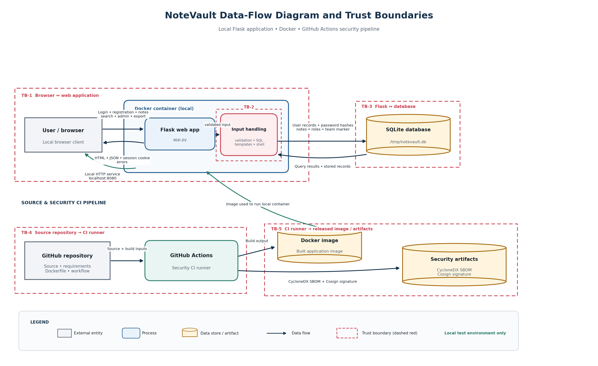

# Term Project Report — Secure Build

> Fill in every section. Keep the headings. Total **100 pts** (see rubric at the end).
> This is **team work** (2–3). Do not share your report with other teams.

## Cover

| Field | Value |
|---|---|
| Team name | Bits |
| Members (name + ID) | Kay Khine Maw (#6631503060) & Nway Nway Zay Ya (#6631503081) |
| Target application | NoteVault |
| Repository URL | https://github.com/nwaynwayzayya/software-security-project-bits |
| Date | 2026-11-03 |

## AI-tool usage disclosure
*Academic integrity: state how you used any AI tools (ChatGPT, Copilot, etc.) — e.g. searching, coding, translating, drafting. "None" is a valid answer.*

| Tool | How it was used |
|---|---|
| GitHub Copilot / Copilot SDK | Assisted with repository inspection, security test planning, command explanations, and report organization. The team performed the local testing and reviewed the resulting evidence. |

---

## 1. Executive Summary
NoteVault is a local Flask note-sharing application with registration, login, note
creation, search, an administrator view, and an export endpoint backed by SQLite.
The assessment confirmed 13 findings in the vulnerable baseline: 1 Critical, 10
High, and 2 Medium. The most serious issues were forged administrator sessions,
SQL injection, command injection, broken object-level authorization, stored XSS,
weak password protection, and an insecure container configuration.

The remediation branch moves the signing secret to runtime configuration, restricts
JWT algorithms, parameterizes SQL, enforces note ownership and fixed registration
roles, escapes rendered content, removes shell execution, replaces MD5 with
adaptive password hashing, removes password fields from admin responses, adds
CSRF protection, disables debug mode, upgrades dependencies, and runs the image as
UID 10001. Post-remediation tests blocked the original exploits. Final CI results
and the local release archive has a recorded Cosign verification result.

---

## 2. System Scope & Function
- What the application does; in-scope components and endpoints.
- **Data-Flow Diagram (DFD):** processes, data stores, external entities, **trust boundaries** (insert image).

NoteVault is a Flask web application that supports local user registration, login, note creation, note retrieval, note search, an administrator view, and an export convenience endpoint. The application stores users and notes in SQLite and runs locally in a Docker container.

****Data-Flow Diagram**


The in-scope components are:

- `app.py`: Flask routes, authentication, authorization, database access, rendering, and export behavior.
- `requirements.txt`: Python dependency versions.
- `Dockerfile`: Container image construction and runtime configuration.
- `docker-compose.yml`: Local container execution.
- `.github/workflows/security-ci.yml`: SAST, SCA, secret scanning, container scanning, and SBOM generation.
- `FINAL-REPORT.md`: Security findings, remediation evidence, and supply-chain documentation.

The in-scope endpoints are `/`, `/register`, `/login`, `/logout`, `/notes`, `/api/notes/<id>`, `/search`, `/admin`, and `/export`.

### Baseline environment

- Repository: `nwaynwayzayya/software-security-project-bits`
- Branch: `main`
- Baseline tag: `vulnerable-baseline`
- Baseline commit: `b3a1e5d` followed by the full commit hash from `evidence/baseline/baseline-commit.txt`
- Runtime: Docker Compose
- Local URL: `http://localhost:8080`
- Team marker: configured through `TEAM_ID`; the value itself is not a secret and should be recorded only if your course requires it

---

## 3. Threat Model — STRIDE  *(20 pts)*

| Element / data flow | S | T | R | I | D | E | Top threat & mitigation |
|---|---|---|---|---|---|---|---|
| Browser → Flask login | Forged session | Login input altered | Weak audit trail | Session disclosure | Login abuse | Privilege escalation | Use strong secret management, parameterized SQL, secure cookies, and logging |
| Browser → notes/search | Session misuse | Note content altered | No request integrity | IDOR/XSS exposes notes | Search abuse | Admin role abuse | Enforce ownership, escape output, add CSRF protection |
| Flask → SQLite | Unauthorized reads | Data modification | Limited auditability | Password/hash disclosure | Expensive queries | SQL-driven privilege abuse | Parameterized queries, least privilege, restricted responses |
| Flask → shell/export | Command execution | Output manipulation | No command audit | Host/container disclosure | Resource exhaustion | Container escape risk | Remove shell execution and use allowlisted formats |
| Repository → CI/image | Malicious dependency | Workflow tampering | Weak provenance | Secret leakage | Build exhaustion | Supply-chain compromise | Pin actions, scan dependencies/images, generate SBOM, sign artifacts |

*Then rank the top 5 risks by likelihood × impact.*

| Rank | Risk | Likelihood | Impact | Rating | Reason |
|---|---|---:|---:|---:|---|
| 1 | Forged administrator session | High | Critical | Critical | Secret is exposed and admin identity can be forged |
| 2 | SQL injection and command injection | High | High | Critical | User input reaches SQL and shell interpreters |
| 3 | Broken object-level authorization | High | High | High | Any authenticated user can read another user's note |
| 4 | Stored XSS | Medium | High | High | Stored content executes in another user's browser |
| 5 | Vulnerable dependencies/container | Medium | High | High | Old components and root container increase compromise impact |

---

## 4. Vulnerability Findings  *(25 pts)*

One block per finding (copy as needed):

### Finding F-01 — Forged administrator session token

| Field | Value |
|---|---|
| CWE | CWE-347 — Improper Verification of Cryptographic Signature; CWE-798 — Use of Hard-coded Credentials |
| OWASP 2025 | A07 — Identification and Authentication Failures |
| Severity | Critical |
| Location | `app.py`: hard-coded `SECRET`, `current_user()`, and `/admin` authorization |
| Reproduction | A request without a session and a request using a normal Alice session returned HTTP 403. A locally generated HS256 JWT with `sub=admin`, signed using the exposed development secret, was then sent as the `session` cookie to `GET http://localhost:8080/admin`. The response returned HTTP 200 and administrator records. |
| Impact | An attacker who knows the exposed signing secret can forge an authenticated administrator identity and access administrative functionality. |
| Evidence | `evidence/findings/F-01-forged-session.txt` and `evidence/findings/screenshots/F-01-forged-session.png` |

- The root cause is the hard-coded session-signing secret and insufficiently robust JWT validation. The application also lists `none` among the accepted algorithms. The confirmed working exploit in the installed environment used a forged HS256 token.


### Finding F-02 — SQL injection in login

| Field | Value |
|---|---|
| CWE | CWE-89 — Improper Neutralization of Special Elements used in an SQL Command |
| OWASP 2025 | A03 — Injection |
| Severity | High |
| Location | `app.py`, `/login` route, SQL query construction |
| Reproduction | A normal request using Alice's username and an incorrect password returned HTTP 401. A request using `username=' OR 1=1 -- ` and any password returned HTTP 302, set a session cookie, and redirected to `/`. |
| Impact | An unauthenticated attacker can bypass password authentication and obtain an authenticated application session. |
| Evidence | `evidence/findings/F-02-login-sqli.txt` and `evidence/findings/screenshots/F-02-login-sqli.png` |

- The root cause is direct interpolation of attacker-controlled username data into a SQL statement. Parameterized queries are required so the input remains data rather than SQL syntax.


### Finding F-03 — Privilege escalation through self-registration

| Field | Value |
|---|---|
| CWE | CWE-269 — Improper Privilege Management; CWE-266 — Incorrect Privilege Assignment |
| OWASP 2025 | A01 — Broken Access Control |
| Severity | High |
| Location | `app.py`, `/register` route |
| Reproduction | A normal registration without a role produced a non-administrator account. A second disposable registration submitted `role=admin`, and the new account then accessed `GET http://localhost:8080/admin` with HTTP 200. |
| Impact | An unauthenticated user can create an administrator account and access administrative data. |
| Evidence | `evidence/findings/F-03-role-escalation.txt` and `evidence/findings/screenshots/F-03-role-escalation.png` |

- The root cause is client-controlled assignment of a server-side authorization attribute. Public registration must ignore the submitted role and assign a fixed non-privileged role.


### Finding F-04 — Insecure direct object reference in note retrieval

| Field | Value |
|---|---|
| CWE | CWE-639 — Authorization Bypass Through User-Controlled Key |
| OWASP 2025 | A01 — Broken Access Control; API1:2023 — Broken Object Level Authorization |
| Severity | High |
| Location | `app.py`, `/api/notes/<int:nid>` route |
| Reproduction | Alice successfully reads her own note at `/api/notes/1`. Using the same authenticated session, she changes only the identifier to `/api/notes/2` and receives the administrator-owned note with HTTP 200. An unauthenticated request is rejected with HTTP 401. |
| Impact | Any authenticated user can read another user's note by changing the numeric note ID. |
| Evidence | `evidence/findings/F-04-idor.txt` and `evidence/findings/screenshots/F-04-idor.png` |

- The root cause is that the endpoint checks authentication but does not check ownership. The database query filters only by note ID. The secure query must constrain both the note ID and the authenticated owner.


### Finding F-05 — SQL injection in search

| Field | Value |
|---|---|
| CWE | CWE-89 — Improper Neutralization of Special Elements used in an SQL Command |
| OWASP 2025 | A03 — Injection |
| Severity | High |
| Location | `app.py`, `/search` route |
| Reproduction | Log in as Alice and perform a normal search for `milk`. Then submit the search payload `%' OR owner='admin' -- `. The vulnerable query can be altered so that administrator-owned notes appear in Alice's search results. |
| Impact | An authenticated user can manipulate the search query and potentially read notes outside the user's ownership scope. |
| Evidence | `evidence/findings/F-05-search-sqli.txt` and `evidence/findings/screenshots/F-05-search-sqli.png` |

- The root cause is that both the authenticated username and attacker-controlled search term are interpolated into SQL. The owner and search pattern must be passed as SQL parameters.


### Finding F-06 — Stored cross-site scripting in note rendering

| Field | Value |
|---|---|
| CWE | CWE-79 — Improper Neutralization of Input During Web Page Generation |
| OWASP 2025 | A05 — Injection |
| Severity | High |
| Location | `app.py`, homepage template and `/search` response rendering |
| Reproduction | Log in as Alice and create a note containing `<script>alert(document.domain)</script>`. Visit `http://localhost:8080/`. The stored script executes in the browser when the note is rendered. |
| Impact | An attacker can store script content that executes in another user's browser when the note is viewed. This could enable session abuse or actions in the victim's browser. |
| Evidence | `evidence/findings/F-06-xss.txt`, `evidence/findings/screenshots/F-06-xss-home.png`, and `evidence/findings/screenshots/F-06-xss-alert.png` |

- The root cause is string-built HTML combined with `|safe`, which disables Jinja's normal escaping. User-controlled note values must be passed as structured template data and rendered with contextual escaping.


### Finding F-07 — Command injection in export

| Field | Value |
|---|---|
| CWE | CWE-78 — Improper Neutralization of Special Elements used in an OS Command |
| OWASP 2025 | A03 — Injection |
| Severity | High |
| Location | `app.py`, `/export` route |
| Reproduction | Authenticate as Alice and request `/export?fmt=txt%3Bid`. The vulnerable route passes the attacker-controlled value to `subprocess.run(..., shell=True)`, causing the harmless `id` command to execute and return output. |
| Impact | An authenticated attacker can execute operating-system commands in the application process context. |
| Evidence | `evidence/findings/F-07-command-injection.txt` and `evidence/findings/screenshots/F-07-command-injection.png` |

- The root cause is concatenating attacker-controlled input into a shell command and enabling `shell=True`. The export behavior should be implemented directly in Python or use a strict allowlist with argument-list execution and `shell=False`.


### Finding F-08 — Weak MD5 password hashing and password-hash disclosure

| Field | Value |
|---|---|
| CWE | CWE-327 — Use of a Broken or Risky Cryptographic Algorithm; CWE-916 — Use of Password Hash With Insufficient Computational Effort; CWE-200 — Exposure of Sensitive Information |
| OWASP 2025 | A04 — Cryptographic Failures |
| Severity | High |
| Location | `app.py`, password creation/login logic and `/admin` route |
| Reproduction | Authenticate as the local administrator and request `GET http://localhost:8080/admin`. The response contains a `password` property for each user. Source inspection confirms the values are generated with MD5. |
| Impact | Password hashes are disclosed to clients and can be cracked more easily because MD5 is fast and not an appropriate password-storage algorithm. |
| Evidence | `evidence/findings/F-08-password-disclosure.txt` and `evidence/findings/screenshots/F-08-password-disclosure.png` |

- The root cause has two parts: the application uses MD5 instead of a slow password-hashing scheme such as Argon2id, bcrypt, or scrypt, and the administrator endpoint serializes the password column into its JSON response. Password hashes must never be returned to clients.


### Finding F-09 — Missing security attributes on session cookie

| Field | Value |
|---|---|
| CWE | CWE-614 — Sensitive Cookie in HTTPS Session Without Secure Attribute; CWE-1004 — Sensitive Cookie Without HttpOnly Flag |
| OWASP 2025 | A07 — Identification and Authentication Failures |
| Severity | Medium |
| Location | `app.py`, `/login` and `/logout` cookie handling |
| Reproduction | Log in normally and inspect the `Set-Cookie` response header. The session cookie is issued without `HttpOnly`, `Secure`, or `SameSite` attributes. |
| Impact | Browser-side scripts may access the session token, and the token may be sent in unsafe cross-site contexts. |
| Evidence | `evidence/findings/F-09-cookie-security.txt` and `evidence/findings/screenshots/F-09-cookie-security.png` |


### Finding F-10 — Missing CSRF protection

| Field | Value |
|---|---|
| CWE | CWE-352 — Cross-Site Request Forgery |
| OWASP 2025 | A01 — Broken Access Control |
| Severity | Medium |
| Location | `app.py`, state-changing POST routes including `/notes` and `/register` |
| Reproduction | Authenticate as Alice and submit `POST /notes` without a CSRF token. The request is accepted even when an external-looking `Origin` header is supplied. |
| Impact | A victim's authenticated browser could be induced to perform actions without the victim intentionally submitting the form. |
| Evidence | `evidence/findings/F-10-csrf.txt` and `evidence/findings/screenshots/F-10-csrf.png` |


### Finding F-11 — Flask debug mode and broad network binding

| Field | Value |
|---|---|
| CWE | CWE-489 — Active Debug Code; CWE-16 — Configuration |
| OWASP 2025 | A05 — Injection / A10 — Mishandling of Exceptional Conditions |
| Severity | High |
| Location | `app.py`, application startup |
| Reproduction | Inspect the startup configuration and run the application locally. The app uses `debug=True` and binds to `0.0.0.0`. A controlled malformed request may expose development traceback information. |
| Impact | Detailed errors can disclose source paths, SQL statements, configuration details, and implementation information. Broad binding increases unintended network exposure. |
| Evidence | `evidence/findings/F-11-debug-mode.txt` and  `evidence/findings/screenshots/F-11-debug-mode.png` |


### Finding F-12 — Outdated and vulnerable dependency stack

| Field | Value |
|---|---|
| CWE | CWE-1104 — Use of Unmaintained Third-Party Components |
| OWASP 2025 | A06 — Vulnerable and Outdated Components |
| Severity | High |
| Location | `requirements.txt` and the container image |
| Reproduction | Inspect the pinned dependency versions and run the repository Trivy/SCA scan. The baseline scan reports high-severity dependency or image findings. |
| Impact | Known vulnerabilities in framework, HTTP, templating, or cryptographic components can compromise confidentiality, integrity, or availability. |
| Evidence | `evidence/findings/F-12-dependencies.txt` and  `evidence/findings/screenshots/F-12-dependencies.png` |


### Finding F-13 — Insecure Docker container configuration

| Field | Value |
|---|---|
| CWE | CWE-250 — Execution with Unnecessary Privileges; CWE-16 — Configuration |
| OWASP 2025 | A05 — Security Misconfiguration |
| Severity | High |
| Location | `Dockerfile` and container runtime configuration |
| Reproduction | Inspect and build the image, then run `docker compose run --rm notevault id`. The image uses a mutable base tag, copies the entire build context, includes a secret-like environment value, and runs as root. |
| Impact | A container compromise has greater impact when the process runs as root. Broad build context and embedded secrets increase leakage and supply-chain risk. |
| Evidence | `evidence/findings/F-13-container.txt` and  `evidence/findings/screenshots/F-13-container.png` |


---

## 5. Remediation  *(25 pts)*

Per finding: the fix, **before/after** code, and the commit that implements it.

The remediation was implemented locally and verified against the vulnerable attack
procedures. Commit hashes should be filled in after the remediation commits are
created and pushed.

### Fixes for F-01, F-09, and F-11 — authentication and runtime configuration

```diff
- data = jwt.decode(tok, SECRET, algorithms=["HS256", "none"])
+ data = jwt.decode(tok, SECRET, algorithms=["HS256"])
- resp.set_cookie("session", tok)
+ resp.set_cookie("notevault_session", tok, httponly=True,
+                 secure=SESSION_COOKIE_SECURE, samesite="Lax")
- app.run(host="0.0.0.0", port=8080, debug=True)
+ app.run(host=NOTEVAULT_HOST, port=NOTEVAULT_PORT, debug=False)
```

- **Why this fixes it:** The signing secret is injected at runtime, `none` is not
  accepted, the CSRF session and authentication cookie are separate, cookie
  protections are configured, and the Werkzeug debugger is disabled.
- **Commit:** `4d9c831`
- **Proof:** `evidence/remediation/F-01-forged-session-blocked.txt`,
  `F-09-cookie-secured.txt`, and `F-11-debug-disabled.txt`.

### Fixes for F-02 and F-05 — SQL injection

```diff
- q = "SELECT ... WHERE username = '%s'" % username
- rows = con.execute(q).fetchall()
+ rows = con.execute(
+     "SELECT ... WHERE username = ? AND body LIKE ?",
+     (username, f"%{term}%"),
+ ).fetchall()
```

- **Why this fixes it:** User input is passed as SQL parameters and cannot change
  the SQL statement structure.
- **Commit:** `4d9c831`
- **Proof:** `evidence/remediation/F-02-login-sqli-blocked.txt` and
  `F-05-search-sqli-blocked.txt`.

### Fixes for F-03 and F-04 — authorization

- Registration ignores client-supplied roles and always creates a `user`.
- Note retrieval filters by both note ID and authenticated owner.
- **Commit:** `4d9c831`
- **Proof:** `evidence/remediation/F-03-role-escalation-blocked.txt` and
  `F-04-idor-blocked.txt`.

### Fixes for F-06 and F-07 — output and command execution

- Notes and search results are passed as structured template data, allowing Jinja
  escaping to prevent stored XSS.
- Export accepts only the allowlisted `txt` format and no longer invokes a shell.
- **Commit:** `4d9c831`
- **Proof:** `evidence/remediation/F-06-xss-escaped.txt` and
  `F-07-command-injection-blocked.txt`.

### Fix for F-08 — password protection and data minimization

- MD5 was replaced with Werkzeug's adaptive password hashing and verification.
- The admin response selects only `id`, `username`, and `role`; password hashes
  are never serialized.
- **Commit:** `4d9c831`
- **Proof:** `evidence/remediation/F-08-password-protected.txt`.

### Fix for F-10 — CSRF protection

- Flask-WTF `CSRFProtect` validates state-changing requests.
- Login, registration, and note forms include a CSRF token.
- **Commit:** `4d9c831`
- **Proof:** `evidence/remediation/F-10-csrf-blocked.txt`.

### Fixes for F-12 and F-13 — dependencies and container

- Dependencies were upgraded to maintained versions.
- The image uses a pinned slim base, copies only required runtime files, does not
  bake in an application secret, and runs as UID 10001.
- **Commit:** `1cc52da`
- **Proof:** `evidence/remediation/F-12-dependencies-rescanned.txt` and
  `F-13-container-hardened.txt`.

---

## 6. Supply-Chain Hardening  *(15 pts)*

- **SBOM:** CycloneDX JSON generated at
  `evidence/supply-chain/sbom.json`. It contains 7 direct components from
  `requirements.txt`, including PyJWT 2.14.0 and urllib3 2.8.0 after the
  Trivy findings were remediated.
- **Image build:** The hardened image builds locally as
  `software-security-project-notevault:latest`.
- **Image record:** The local image digest is recorded in
  `evidence/supply-chain/image-digest.txt`.
- **Cosign:** A local release archive can be signed and verified with an
  ephemeral key kept outside the repository. The local artifact,
  `evidence/supply-chain/notevault-final.tar`, was verified successfully with
  the Cosign bundle in `evidence/supply-chain/notevault-final.bundle`; the
  public key is in `evidence/supply-chain/cosign.pub`. For a production
  release, sign the immutable registry image digest and record the verification
  output in `evidence/supply-chain/cosign-verify.txt`. No private signing key
  is stored in this repository.
- **SLSA self-assessment:** The project currently demonstrates partial Level 1
  practices: a repeatable GitHub Actions workflow, a generated SBOM, pinned
  action references, and a reviewable commit history. It is not claimed as a
  higher SLSA level because the project does not yet provide a fully verified
  hosted provenance attestation for the signed release artifact.

---

## 7. Security CI Pipeline  *(10 pts)*

- **Workflow:** `.github/workflows/security-ci.yml`
- **GitHub Actions:** https://github.com/nwaynwayzayya/software-security-project-bits/actions
- **Baseline failure evidence:** The original vulnerable baseline failed Semgrep
  and Trivy HIGH/CRITICAL gates. Retain the failed run screenshot as evidence
  that the pipeline blocks risky code.
- **Final verification:** All six jobs passed in the merged `main` workflow run.
- **Baseline failure screenshot:** `evidence/ci/baseline-failure.png`
- **Final success screenshot:** `evidence/ci/final-success.png`
- **Final run:** [NoteVault Security CI run 17](https://github.com/nwaynwayzayya/software-security-project-bits/actions/runs/41630264442)

- **Gate behavior:** Python compilation and SBOM generation must complete;
  Semgrep uses `--severity ERROR --error`; Trivy filesystem and image scans use
  `HIGH,CRITICAL` with `exit-code: "1"`; Gitleaks scans repository history.

---

## 8. Conclusion & Reflection  *(5 pts — clarity)*
The project reduced the highest risks by moving from an intentionally vulnerable
baseline to parameterized database access, explicit authorization checks,
escaped rendering, CSRF validation, runtime secret injection, safer cookies,
maintained dependencies, and a non-root container. The baseline tag preserves
the original application for reproducible before/after comparison.

Future hardening could include publishing and signing a registry image digest,
using a production WSGI server, centralized audit logging, rate limiting, secret
rotation, HTTPS, automated dependency update review, and more comprehensive
automated tests. The required local archive signing and post-remediation CI
verification are complete.

The main lesson was that security controls must be tested together: adding CSRF
protection initially exposed a cookie-name collision, which was corrected by
separating the framework session cookie from the JWT authentication cookie.

---

## Appendix
- **Tools:** Docker Compose, PowerShell, curl, Semgrep, Trivy, Gitleaks,
  CycloneDX, GitHub Actions, and Cosign.
- **References:** OWASP Top 10, OWASP API Security Top 10, CWE-78, CWE-79,
  CWE-89, CWE-200, CWE-250, CWE-327, CWE-352, CWE-639, CWE-916, and CWE-1104.
- **Task split:** Kay Khine Maw completed baseline capture, attack testing,
  evidence collection, threat modeling, and report drafting. Nway Nway Zay Ya
  should review the remediation branch, final CI run, release signing, and
  presentation/demo preparation.
- **Ethics:** All exploitation was performed only against the authorized local
  NoteVault sandbox. No public deployment, real credentials, or external target
  was used.

---

## Grading rubric (100)

| Criterion | Pts |
|---|---|
| Threat model quality & completeness (§3) | 20 |
| Vulnerability findings — correctness, CWE/OWASP mapping, depth (§4) | 25 |
| Remediation quality — correct, minimal, well-explained (§5) | 25 |
| Supply-chain hardening — SBOM + signing + provenance (§6) | 15 |
| CI pipeline — works, fails build appropriately (§7) | 10 |
| Presentation & report clarity (§1, §8) | 5 |

*All work stays within the [ethics policy](ETHICS.md).*
